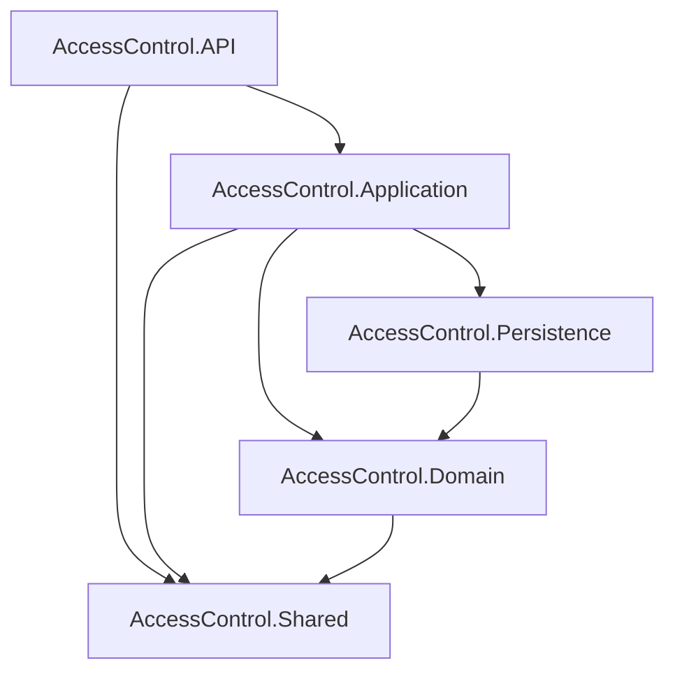

## 📁 Proyecto: `AccessControl`

```
AccessControl.sln
│
├── 📁 AccessControl.API             # Proyecto de presentación (Web API Controllers)
│   ├── Program.cs
│   ├── appsettings.json
│   └── Controllers
│       └── AuthController.cs
│       └── OwnersController.cs
│       └── VisitsController.cs
│       └── MenuController.cs
│       └── DashboardController.cs
│
├── 📁 AccessControl.Application     # Lógica de negocio e interfaces
│   ├── Interfaces
│   │   └── IAuthService.cs
│   │   └── IVisitService.cs
│   │   └── IMenuService.cs
│   │   └── IDashboardService.cs
│   └── Services
│       └── AuthService.cs
│       └── VisitService.cs
│       └── MenuService.cs
│       └── DashboardService.cs
│
├── 📁 AccessControl.Domain          # Entidades del dominio
│   └── Entities
│       └── User.cs
│       └── Residence.cs
│       └── Visit.cs
│       └── Menu.cs
│       └── RoleMenu.cs
│
├── 📁 AccessControl.Persistence     # Acceso a datos (EF Core, DbContext, repositorios)
│   ├── ApplicationDbContext.cs
│   ├── Generics
│   │   └── IRepository.cs
│   │   └── Repository.cs
│   └── Migrations
│       └── [Archivos de Migración de EF]
│
└── 📁 AccessControl.Shared          # DTOs, Enums, y código común
    ├── Dtos
    │   ├── Auth
    │   │   └── AuthDtos.cs
    │   └── Visit
    │       └── CreateVisitDto.cs
    │       └── UpdateVisitDto.cs
    │       └── VisitFilterDto.cs
    └── Enums
        └── Role.cs
```

---

###  Diagrama de Flujo de Capas



### Reglas de Codificación

*   **Nombres de proyectos:** `AccessControl.ProjectName`
*   **Nombres de archivos:** `ClassName.cs`
*   **Nombres de clases:** `PascalCase`
*   **Nombres de métodos:** `PascalCaseAsync` (para métodos asíncronos)
*   **Nombres de variables:** `camelCase`
*   **Interfaces:** `IPascalCase`
*   **DTOs:** `PascalCaseDto`
*   **Inyección de dependencias:** Usar el constructor para inyectar dependencias.
*   **Controladores:** Deben ser delgados y delegar la lógica de negocio a los servicios.
*   **Servicios:** Contienen la lógica de negocio y usan repositorios para acceder a los datos.
*   **Repositorios:** Abstraen el acceso a los datos y usan el `DbContext` de Entity Framework Core.
*   **Entidades:** Clases simples que representan las tablas de la base de datos.
*   **DTOs:** Clases simples para transferir datos entre capas.

### Patrón Repository

Este proyecto utiliza el patrón Repository para abstraer el acceso a los datos. La implementación genérica se encuentra en `AccessControl.Persistence/Generics` y consta de una interfaz `IRepository<T>` y una clase `Repository<T>`. Esto permite realizar operaciones CRUD (Crear, Leer, Actualizar, Eliminar) de forma estandarizada para cualquier entidad del dominio.

### Uso de DTOs en el Proyecto Común

Los Data Transfer Objects (DTOs) se utilizan para transferir datos entre las diferentes capas de la aplicación. Se encuentran en el proyecto `AccessControl.Shared`, lo que permite que sean utilizados tanto por el backend como por el frontend (si fuera necesario). Esto ayuda a mantener un bajo acoplamiento entre las capas y a definir contratos de datos claros.

### Buenas Prácticas de Validación y Seguridad

*   **Validación:** Usar `FluentValidation` para validar los DTOs de entrada en la capa de la API.
*   **Autorización:** Usar políticas de autorización para restringir el acceso a los endpoints.
*   **Autenticación:** Usar JWT para autenticar a los usuarios.
*   **Secretos:** Usar el `Secret Manager` de .NET para almacenar secretos en desarrollo.
*   **CORS:** Configurar CORS para permitir solicitudes solo desde el frontend.

### Cómo Agregar Nuevos Endpoints y Repositorios

**Agregar un nuevo repositorio:**

1.  Crear una nueva interfaz en `AccessControl.Application/Interfaces` que herede de `IRepository<T>`.
2.  Crear una nueva clase en `AccessControl.Persistence/Repositories` que implemente la nueva interfaz y herede de `Repository<T>`.
3.  Registrar el nuevo repositorio en `Program.cs`.

**Agregar un nuevo endpoint:**

1.  Crear un nuevo DTO en `AccessControl.Shared/Dtos` si es necesario.
2.  Crear un nuevo método en la interfaz del servicio en `AccessControl.Application/Interfaces`.
3.  Implementar el nuevo método en la clase del servicio en `AccessControl.Application/Services`.
4.  Crear un nuevo método en el controlador en `AccessControl.API/Controllers` que use el nuevo método del servicio.

---
### 🔐 Nota de Seguridad: Gestión de Secretos

`appsettings.json` no contiene secretos. La API **no arranca** si falta la cadena de conexión o si
la clave JWT tiene menos de 32 bytes, y el mensaje de error dice cuál falta.

**Desarrollo** — .NET Secret Manager, desde `backend/AccessControl.API`:

```bash
dotnet user-secrets set "ConnectionStrings:DefaultConnection" "Host=<HOST>;Database=<BD>;Username=<USUARIO>;Password=<CONTRASEÑA>;Ssl Mode=Require"
dotnet user-secrets set "Jwt:Key" "<CLAVE_ALEATORIA_DE_32_BYTES_O_MÁS>"
```

Una clave válida se genera con `openssl rand -base64 32`.

**Despliegue** — variables de entorno:

| Variable | Contenido |
| --- | --- |
| `ConnectionStrings__DefaultConnection` | Cadena de conexión de PostgreSQL |
| `Jwt__Key` | Clave de firma de los tokens |
| `Cors__AllowedOrigins__0` | Origen del frontend (se pueden añadir `__1`, `__2`…) |

**Migraciones** — `dotnet ef migrations add` no necesita base de datos. `dotnet ef database update`
usa la variable de entorno `ConnectionStrings__DefaultConnection`.

### 🧪 Pruebas

```bash
cd backend
dotnet test AccessControl.Tests -c Release
```

Las pruebas de integración (`AccessControl.Tests/Integration`) arrancan la API en memoria contra un
**PostgreSQL real**: el paquete `MysticMind.PostgresEmbed` descarga los binarios la primera vez y
levanta una instancia temporal, sin Docker ni instalación. Aplican todas las migraciones, así que
una migración rota hace fallar la suite. Para usar un PostgreSQL propio, definir
`TEST_DB_CONNECTION` con su cadena de conexión.

Los usuarios de prueba son los sembrados en `DataSeeder` (admin, guard y owner).

### 🗄️ Base de datos local para desarrollo

Para trabajar sin tocar la base compartida:

```bash
dotnet run --project backend/AccessControl.DevDb -c Release
```

```bash
dotnet run --project backend/AccessControl.API -c Release --launch-profile local-db
```

El primero deja un PostgreSQL en `localhost:5433` (datos en `%LOCALAPPDATA%/AccessControl/devdb`).
El segundo arranca la API en `http://localhost:5080` contra esa base y aplica las migraciones al
iniciar. El frontend se conecta a ella con `npm run start:local` (puerto 4401).

### 👤 Creación de Usuarios

Solo un usuario `Admin` crea y edita usuarios (pantalla "Residentes" o API).

| Operación | Endpoint | Notas |
| --- | --- | --- |
| Crear | `POST /api/users` | Correo duplicado → 409. Contraseña de 8 caracteres o más. |
| Editar | `PUT /api/users/{id}` | Solo nombre, apellido y apartamento; no cambia contraseña ni rol. |

```json
{
  "email": "usuario@example.com",
  "firstName": "John",
  "lastName": "Doe",
  "apartmentNumber": "101",
  "password": "UnaContraseñaSegura123!",
  "role": 2
}
```

Roles: `0` Admin, `1` Guard, `2` Owner.

### ⚠️ Errores

Los controladores no capturan excepciones. Los servicios lanzan las de
`AccessControl.Application/Exceptions` y `GlobalExceptionHandler` las traduce:

| Excepción | HTTP |
| --- | --- |
| `BusinessRuleException` y validación de DTO | 400 |
| `ForbiddenException` | 403 |
| `NotFoundException` | 404 |
| `ConflictException` | 409 |
| cualquier otra | 500 con mensaje genérico; el detalle queda en el log |
